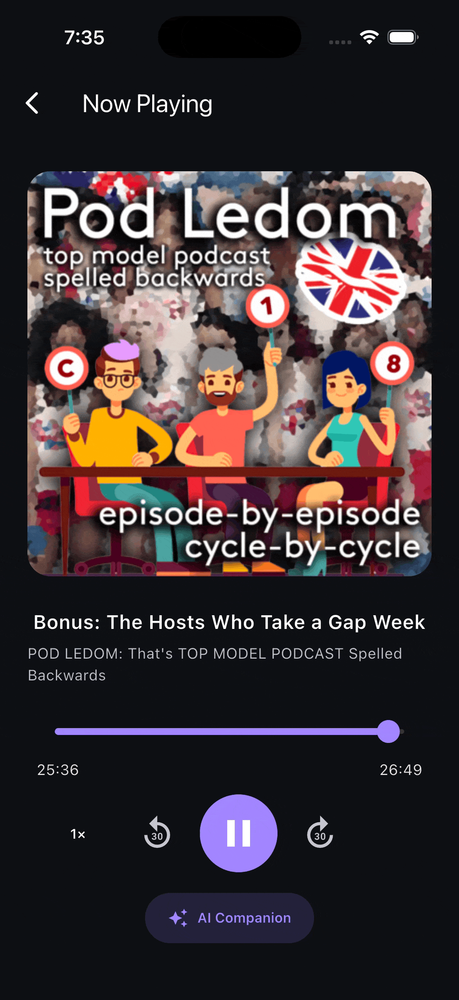
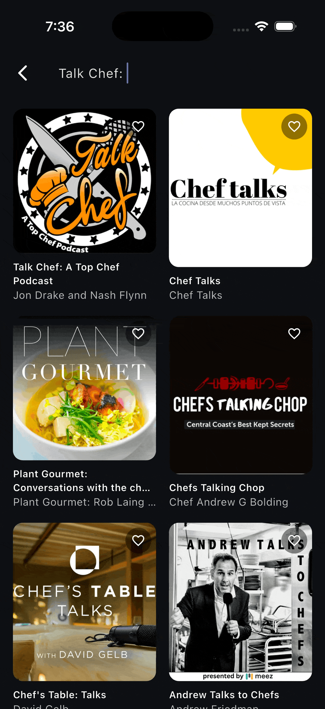

# Cabina

A podcast app built with Flutter. Search podcasts, open a show to browse its episodes, and stream an
episode. A personal Library lets you keep the shows you follow. And now, while you listen, the AI
Companion gives you a synced transcript, a summary and chapters.

This is my delivery for the Labhouse Flutter technical test.

## For the reviewer

Everything the brief asks for is in this file. If you only have five minutes, this is the map:

| The brief asks for                         | Where                                                                    |
|--------------------------------------------|--------------------------------------------------------------------------|
| Env vars and how to run the project        | [Running](#running)                                                      |
| Task 1 prioritized plan                    | [Task 1: prioritized plan](#task-1-prioritized-plan)                     |
| AI Companion approach and key decisions    | [AI Companion: approach and key decisions](#ai-companion-approach-and-key-decisions) |
| How long it took                           | [How long it took](#how-long-it-took)                                    |
| Where and how I used AI tools              | [Where and how I used AI tools](#where-and-how-i-used-ai-tools)          |
| Screen recording                           | [Demo](#demo): screen captures here, and the full video in the zip       |

And if you want to know *why* the repository looks the way it does, read
[`docs/marcos_brain.md`](docs/marcos_brain.md) and
[`docs/ai_companion/marcos_brain.md`](docs/ai_companion/marcos_brain.md). That's where my head is.

## Demo

Two ways to see it:

- **Screen captures**, right below. Short GIFs, one per flow, so you can see each one without
  opening anything. They live in [`assets/`](assets/).
- **The full screen recording**, attached in the zip next to this repository. It walks through the
  final state of the app, with the AI Companion and the Task 1 fixes.

### AI Companion

<table>
  <tr>
    <td align="center" valign="top" width="33%">
      <br>
      <b>The whole flow</b><br>
      <sub>Tap "AI Companion", it gets ready, then the synced transcript, the summary and the chapters.</sub>
    </td>
    <td align="center" valign="top" width="33%">
      <br>
      <b>The transcript follows the audio</b><br>
      <sub>Drag the progress bar and the transcript jumps to the sentence at that position.</sub>
    </td>
    <td align="center" valign="top" width="33%">
      <br>
      <b>A long episode, no transcript</b><br>
      <sub>Over 25 MB and nothing in the RSS: it says so, and nothing is uploaded (<a href="docs/ai_companion/README.md#edge-cases">E4</a>).</sub>
    </td>
  </tr>
</table>

### Task 1 fixes

<table>
  <tr>
    <td align="center" valign="top" width="33%">
      <br>
      <b>Favourites and search</b><br>
      <sub>The favourite tap works again, and search is debounced.</sub>
    </td>
    <td align="center" valign="top" width="33%">
      <br>
      <b>Library</b><br>
      <sub>Subscribing and unsubscribing updates the Library tab right away.</sub>
    </td>
    <td width="33%"></td>
  </tr>
</table>

## Running

### Requirements

- Flutter `3.41.x` (Dart `3.11.x`). The exact version is pinned in `.fvmrc` (`3.41.9`).
- An iOS Simulator / device or an Android emulator / device.

The project pins its Flutter SDK with [FVM](https://fvm.app) so everyone builds against the same
version. Install FVM and the pinned SDK once:

```bash
brew install fvm            # or: dart pub global activate fvm
fvm install                 # reads .fvmrc and installs Flutter 3.41.9
```

Then prefix Flutter/Dart commands with `fvm`. For the IDE: VS Code picks up the SDK automatically via
`.vscode/settings.json`; in Android Studio / IntelliJ set the Flutter SDK path to
`<project>/.fvm/flutter_sdk`.

> Prefer managing Flutter yourself? Any `3.41.x` SDK works, just drop the `fvm` prefix.

### Env vars

There is only one, and only the AI Companion needs it:

| Variable         | Required for       | Where to get it                                                     |
|------------------|--------------------|---------------------------------------------------------------------|
| `OPENAI_API_KEY` | AI Companion only  | [platform.openai.com/api-keys](https://platform.openai.com/api-keys) |

No API key is committed. It lives in a `.env` file at the root, and `.env` is in `.gitignore`:

```bash
cp .env.example .env        # then fill in OPENAI_API_KEY=sk-...
```

There is a single environment, so there is no `env.dart`: the feature reads the key with
`String.fromEnvironment('OPENAI_API_KEY')`. Without the key the app runs fine, and AI Companion says
it isn't available (E1).

### Run

```bash
fvm flutter pub get
fvm dart run build_runner build --delete-conflicting-outputs   # generates *.g.dart
fvm flutter run --dart-define-from-file=.env
```

The app targets **iOS and Android**. How to try each AI Companion path (RSS transcript, short
episode, long episode, no key) is in
[`docs/ai_companion/README.md`](docs/ai_companion/README.md#how-to-try-it-reviewer).

### Tests and gates

```bash
fvm flutter analyze
fvm dart format --set-exit-if-changed .
fvm flutter test
```

## Task 1: prioritized plan

### How I got to the plan

Before asking any AI anything, I used the app. I kept a document open and wrote, by hand, every bug,
improvement and architectural question I found:
[`docs/tasks/human_notes_repo_review.md`](docs/tasks/human_notes_repo_review.md). It stays the way
I wrote it, typos included.

Then, while writing the rules for the agents (`AGENTS.md`), more things showed up. Everything ended
in [`docs/tasks/technical_debt.md`](docs/tasks/technical_debt.md), one line per issue, with its
status (✅ done · 🟡 partial · ❌ open). That file is the source of truth.

### The priority rule

What breaks for the user first, then what lies to the user, then what slows us down. And the player
before the AI Companion, because the AI Companion lives inside the player.

| Priority | What                                                                                                                                                                                                                                 | Why first                                                                     | Status |
|----------|--------------------------------------------------------------------------------------------------------------------------------------------------------------------------------------------------------------------------------------|-------------------------------------------------------------------------------|--------|
| **P0**   | Favourite tap threw (mutating a `const []`). Play button failing sometimes (`await play()` never completes). Audio kept playing after going back. Library not updated after subscribing. Library item tap did nothing. Corrupt prefs crashed on startup. Unexpected errors left the screen loading forever | Core actions that don't work, or a crash. A user hits them in the first minute | ✅     |
| **P1**   | Search with no debounce. Stale error after a successful retry. iTunes durations badly parsed (`hh:mm`, `mm`). One broken RSS item failed the whole feed. Episodes not sorted. Favourite save errors dropped| The app works, but it shows wrong data or wastes requests                     | ✅     |
| **P2**   | Player screen rebuilt on every 200ms, seek bar snapping back, `+30 s` past the end. `SharedPreferences` without a wrapper. `LibraryStore` singleton with a string format that split wrong. `IPlayerService` + a pass-through repository | Performance and structure. The player refactor is what the AI Companion is built on | ✅     |
| **P3**   | `audio_session`, `FavouritesCubit`, 32 dp heart, uneven grid, pagination, search retry and clear buttons, empty episodes view, `ShowDetailBloc` → Cubit, named time zones, shared code into `common/`, router into `lib/router/` | Known and tracked. None of it breaks the app today                            | ❌     |

The full list, with `file:line` and how each one was fixed, is in
[`docs/tasks/technical_debt.md`](docs/tasks/technical_debt.md).

### How it was executed

Every refactor got a plan first, in the format `AGENTS.md` defines (problem, decisions, tests first,
out of scope), approved before any code:

- [`docs/library/plan/01_implementation_plan.md`](docs/library/plan/01_implementation_plan.md):
  `LibraryCubit` over a `LocalStorage` wrapper, migrated storage, tap opens the detail.
- [`docs/player/plan/01_implementation_plan.md`](docs/player/plan/01_implementation_plan.md): only
  the seek bar rebuilds on ticks, `PlayerRepository`, errors reach the UI.

## AI Companion: approach and key decisions

The full story lives in [`docs/ai_companion/`](docs/ai_companion/), in three layers, each one
approved before the next:

1. [`README.md`](docs/ai_companion/README.md): what it does, user actions, happy paths, edge cases,
   user stories. No code.
2. [`plan/01_implementation_plan.md`](docs/ai_companion/plan/01_implementation_plan.md): how it's
   built.
3. The code, one plan step at a time.

Beside them: [`costs/`](docs/ai_companion/costs/) (STT and LLM prices) and
[`marcos_brain.md`](docs/ai_companion/marcos_brain.md) (how I got here). Please read that one, it's
the honest version.

### The approach

An MVP is letting things go, and knowing what we're letting go. So: KISS, a solid base of Lego
pieces, and as few steps as possible for you.

While you listen, the AI Companion gives you three things: the synced transcript with the current
sentence highlighted (like Spotify lyrics), a summary, and chapters with their real start time. Tap a
sentence or a chapter and the audio jumps there.

The pipeline, on the device:

1. The user taps "AI Companion". Nothing happens before that.
2. Is the episode cached on this device? Show it, offline too.
3. Does the RSS publish a transcript (SRT or VTT)? Use it. It's free and ready in seconds.
4. If not, and the audio is 25 MB or less, transcribe it with `whisper-1`.
5. `gpt-5.6-luna` writes the summary and the chapters, with Structured Outputs.
6. Chapter times are matched to real transcript sentences, not taken from the model.
7. Save it, only if everything finished.

### Key decisions

| Decision                                                   | Why                                                                                                                                                                       |
|------------------------------------------------------------|---------------------------------------------------------------------------------------------------------------------------------------------------------------------------|
| A single OpenAI key                                        | You shouldn't have to create accounts with several providers or set up Firebase (no `GoogleService-Info.plist`, no Xcode changes). One key and done                     |
| It only starts when the user taps "AI Companion"           | If someone opens an episode by accident, that shouldn't pay for a transcription nobody asked for                                                                          |
| RSS transcript first, audio second                         | Why pay to transcribe something the podcast already gives us?                                                                                                             |
| Only audio ≤ 25 MB is transcribed                          | That's OpenAI's direct upload limit. Chopping audio on the phone is fragile; that's a server's job                                                                        |
| All or nothing, cached per device                          | No half-done episodes. There's no backend in the MVP, so if two users open the same episode, each one pays. I know, and I accept it for this version                     |
| Chapter times come from the transcript                     | Models get times wrong. This way a chapter always points to a real sentence                                                                                               |
| Heavy parsing in an isolate, the list rebuilds per sentence | The player ticks every 200 ms. A `BlocSelector` picks only the active sentence index, so the list repaints when the sentence changes, not on every tick                 |
| A sheet over the player, not a new screen                  | You don't lose the player. In full screen the controls go to the bottom, where the thumb is                                                                               |
| Generic error messages, details in the log                 | Knowing which API failed doesn't help the listener, and it helps someone who wants to attack the app way too much                                                        |
| The transcript is plain text                               | It comes from third parties. I treat it as data, never as an instruction                                                                                                  |
| A sub-feature inside `player/` (`lib/player/ai_companion/`) | It only lives inside the player's page. It has its own cubit and services, and the player only imports its entry widget                                                  |

### What I would do in production

Think per podcast, not per user. If 10,000 users open the same episode, does it make sense to
transcribe it 10,000 times? No. A backend with a shared cache, keys on the server, Groq
(`whisper-large-v3-turbo`) + a small model like Claude Haiku, and audio chopping on the server for
long episodes. The numbers are in [`costs/stt_costs.md`](docs/ai_companion/costs/stt_costs.md) and
[`costs/llm_costs.md`](docs/ai_companion/costs/llm_costs.md).

## How long it took

The brief says around 8 hours. It took me much more, and on purpose. I used the test to study:
how STT providers work today, what transcribing an hour really costs, how to set up a repository so
any agent works with the same rules as a human.

| What                                       | Time                                                                    |
|--------------------------------------------|-------------------------------------------------------------------------|
| Days with activity                         | 12, from Oct 29 to Nov 12, 2026                                         |
| My time (study, research, coding, review)  | About 4 to 6 hours a day, so roughly **50 to 70 hours**                 |
| Agent active time                          | **13.8 h**, measured, across 382 questions                              |

The agent time is measured, not estimated. I built a plugin for that, `usage-ledger`, which saves
tokens, cost and active time per question, tagged by feature and phase. The numbers and the honest
notes (like two thirds of the cost being `unassigned` because I started tagging late) are in
[`ledger/LEDGER.md`](ledger/LEDGER.md).

What did the agent cost? I used the **Claude Pro plan, 20 USD a month**, and never hit the weekly
limit. The same tokens at API list price would be about 198 USD. A measuring stick, not an invoice.

## Where and how I used AI tools

### The tools

- **Claude Code** with Opus 5.5 (high effort most of the time, medium and xhigh for some phases),
  and Fable 5.2 (medium) for the AI Companion plan.
- **`AGENTS.md` and two skills I wrote**: `feature-refactor` (refactors a feature to the rules and
  stops at the plan for approval) and `staged-audit` (read-only audit of what's staged, P0–P3, scored
  from 1 to 300). See [AI environment](#ai-environment).
- **Two Claude Code plugins I built** for this workflow:
  - **`usage-ledger`** measures what the AI costs, in tokens, money and active time, per feature and
    phase.
  - **`did-i-mess-up`** installs a pre-commit hook that blocks a commit carrying debug or "testing
    on purpose" leftovers, unformatted files, analyze errors or failing tests, and then asks Haiku
    whether I messed something up. A second pair of eyes before every commit.

### Where

| Where                     | How                                                                                                                                       |
|---------------------------|-------------------------------------------------------------------------------------------------------------------------------------------|
| Reviewing the app         | **Not AI.** My handwritten notes came first. The AI found a few more things later, marked as "AI Founded" in the same file               |
| Rules and standards       | `AGENTS.md`, the skills and `technical_debt.md`, written together with the agent, decided by me                                           |
| Plans                     | The agent drafts the plan in the `AGENTS.md` format. I review it, change it, approve it                                                   |
| Code and tests            | Tests first, then the change, one plan step at a time                                                                                     |
| Review                    | `staged-audit` on what I staged, then `did-i-mess-up` on the commit. Plus a lot of questions: 242 of my 382 were me reviewing what the AI did |

### How: the human in the loop

AI is a tool and a teammate, and I review its work like a teammate's PR. If you drive three hours on
a highway, at some point you start deciding on autopilot. I didn't want that with the code, so I set
myself some rules:

- A plan before any code, and it waits for my approval.
- Tests first: the failing case, then the fix. The test checks the code; we don't bend the test to
  match whatever the code does.
- Gates green before handing off: analyze, format, test.
- The agent never runs `git add`, never commits, never pushes. I stage the files by hand.
- Small commits, one problem each.

The longer version is in [`docs/marcos_brain.md`](docs/marcos_brain.md).

## Tech overview

- **State:** `flutter_bloc` (BLoC + Cubit), manual DI via `RepositoryProvider` / `BlocProvider`.
- **Navigation:** `go_router`.
- **Data:**
  - Discover / Search → [iTunes Search API](https://performance-partners.apple.com/search-api)
    (no key).
  - Show detail → the podcast's **RSS feed** (parsed with `package:xml`).
  - Audio → streamed with `just_audio`.
  - Local persistence → `shared_preferences`, behind `LocalStorage`.
  - AI Companion → OpenAI (`whisper-1`, `gpt-5.6-luna`).
- **Models:** `json_serializable` + `equatable` + `copyWith` (run `build_runner` after changing an
  annotated model).
- **Theming:** a `ThemeExtension` (`AppTheme`). Read colors via `context.appTheme`.

### Project layout

```
lib/
  app/              App widget + dependency injection
  common/           Theme, errors, networking, storage, parsers, shared widgets, extensions
  discover/         Discover grid + favourites
  search/           Podcast search
  show_detail/      Podcast detail + RSS feed parsing + episodes
  player/           Audio player (just_audio)
    ai_companion/   Synced transcript, summary and chapters
  library/          The user's followed podcasts
  home/             Bottom-nav shell
```

The full map and the rules are in [`AGENTS.md`](AGENTS.md).

## AI environment

Agents in development went from autocomplete, to harnesses and apps, to repositories that are ready
for an agent like Claude, Gemini or GPT to work in. `AGENTS.md` and the skill files are what make
that possible here: whatever model a dev uses, everyone shares the same environment and the same
rules.

### What's in it

| Path                                           | What it is                                                                                                                                      |
|------------------------------------------------|-------------------------------------------------------------------------------------------------------------------------------------------------|
| `AGENTS.md`                                    | The rules for agents and humans: stack, project map, layers, state, errors, tests, known debt, and when to stop and ask. No `CLAUDE.md`.        |
| `.agent/skills/feature-refactor/`              | Refactors one feature so it follows `AGENTS.md`. Writes a plan in the feature's `plan/` and stops for approval before touching code.            |
| `.agent/skills/staged-audit/`                  | Read-only audit of what's staged. Classifies findings P0–P3 and scores the change from 1 to 300.                                                |
| `docs/<feature>/plan/`                         | One plan per change (`NN_implementation_plan.md`). Problem, decisions, tests first, out of scope. Approved before any code.                     |
| `docs/tasks/technical_debt.md`                 | Known issues and their status (✅ 🟡 ❌). The source of truth.                                                                                  |
| `docs/tasks/human_notes_repo_review.md`        | My handwritten notes from reviewing the app: bugs, improvements, architectural questions.                                                       |
| [`docs/marcos_brain.md`](docs/marcos_brain.md) | Why the repository looks the way it does, and how I think about working with AI.                                                                |
| [`ledger/`](ledger/LEDGER.md)                  | What the AI cost, per feature and phase, measured with `usage-ledger`.                                                                          |

### Setup

Claude Code reads skills from `.claude/skills`, and `.claude/` is git-ignored. Link it once:

```bash
mkdir -p .claude && ln -s ../.agent/skills .claude/skills
```

Other agents read `AGENTS.md` from the root.

### Workflow

1. A plan in `docs/<feature>/plan/`, and it waits for approval.
2. Tests first, then the change.
3. Gates green: `fvm flutter analyze`, `fvm dart format`, `fvm flutter test`.
4. I stage the files by hand. The agent never runs `git add`, commits or pushes.
5. `staged-audit` on what's staged, then the commit.

### usage-ledger

`usage-ledger` is a plugin I built for this workflow. It measures AI usage in time and money
(tokens) every time the AI works on a feature, from the implementation to the questions we ask it
along the way. It's not there to take credit away from the developer's work. It's there to know
what a feature or a refactor really costs.

In Claude Code:

1. `/plugin marketplace add muric-dev/dev-workflow-plugins`
2. `/plugin install usage-ledger@dev-workflow-plugins`
3. From there it runs as `/usage-ledger:usage-ledger`

`feature-refactor` knows `usage-ledger` exists and logs each phase with it. If it isn't installed,
that step is skipped.
